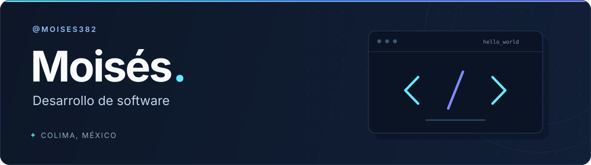

  

  <a href="https://github.com/moises382?tab=repositories"><strong>Explora mis proyectos ↗</strong></a>
  &nbsp;&nbsp;·&nbsp;&nbsp;
  <a href="https://www.facebook.com/profile.php?id=61576752257442">Facebook</a>
  &nbsp;&nbsp;·&nbsp;&nbsp;
  <a href="https://x.com/MoissGalvan5/media">X</a>

## Sobre mí

Soy **Moisés**, un desarrollador de Colima, México. Me gusta resolver problemas, entender cómo funcionan las cosas y convertir ideas en aplicaciones útiles.

Estoy fortaleciendo mis habilidades en desarrollo web. Soy autodidacta, disfruto aprender construyendo y busco oportunidades para aportar a un equipo y crecer con proyectos reales.

## Tecnologías que estoy aprendiendo

  
  
  
  
  
  

Mi enfoque: **bases sólidas, código claro y aprendizaje constante**.

## Proyectos seleccionados

### [Documentación de red institucional ↗](https://github.com/moises382/documentacion-red-institucional)

Aplicación web para organizar el inventario de equipos, visualizar la topología de red y dar seguimiento a la documentación. Versión de portafolio con datos ficticios.

`Next.js` `React` `TypeScript` `SQLite` · Documentación de infraestructura

### [Calendario moderno ↗](https://github.com/moises382/calendario-moderno)

Calendario interactivo con cuenta regresiva, navegación por fechas y visualización del tiempo restante.

`Python` `Tkinter` · Aplicación de escritorio

### [Sistema de calificaciones ↗](https://github.com/moises382/Sistema-de-Calificaciones-)

Proyecto para registrar alumnos, editar calificaciones y calcular promedios desde una interfaz gráfica.

`Flutter` `Dart` · Gestión académica

## Conversemos

¿Tienes una oportunidad o una idea para desarrollar? Me interesa colaborar con personas que disfruten construir y compartir lo que saben.

**[Facebook ↗](https://www.facebook.com/profile.php?id=61576752257442)** · **[X ↗](https://x.com/MoissGalvan5/media)**

---

  Aprender, construir y mejorar. Un proyecto a la vez.

